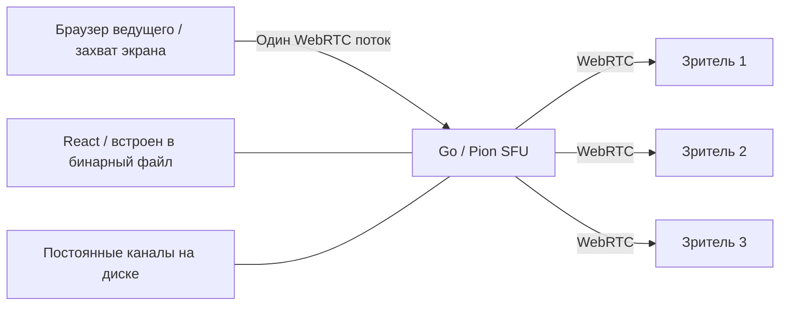

# LANPlay v2

Самостоятельный сервер трансляций экрана: **React + TypeScript** для интерфейса, **Go + Pion WebRTC** для передачи видео и звука. Интерфейс встроен в один исполняемый файл; на устройстве сервера не нужны Node.js, браузер или отдельная папка со статикой.

> Это рабочая alpha новой версии. Прежняя версия Node.js сохранена без изменения исходников в [`stable/`](stable/README.md). Её можно запустить отдельно: `cd stable`, `npm ci`, `npm start`.

## Постоянная ссылка

Ведущий выбирает никнейм, например `cyber`, и получает адрес:

```text
https://stream.example.com/watch/cyber
```

Канал сохраняется в `data/channels.json`. Остановка эфира, закрытие вкладки и перезапуск Go-сервера **не освобождают никнейм**. Между эфирами страница зрителя ждёт начала трансляции, во время эфира подключается автоматически. Уже открытая страница переподключается после следующего старта без обновления ссылки.

Право вести эфир подтверждает случайный 256-битный ключ владельца. Он сохраняется в браузере; скачайте резервную копию в блоке «Ключ владельца и восстановление». Для переноса в другой браузер введите никнейм и этот ключ в форме восстановления. Секрет не входит в ссылку зрителя; на сервере хранится только его хеш.

Постоянство ссылки требует постоянного **адреса сервера**: домена или закреплённого IP в локальной сети. Никнейм сохраняет путь, но не заменяет DNS и маршрутизацию.

## Быстрый запуск

Готовый файл запускается без установки зависимостей:

```powershell
# Windows
.\build\lanplay-windows-amd64.exe --data .\data
```

```sh
# Linux
chmod +x ./lanplay-linux-amd64
./lanplay-linux-amd64 --data ./data
```

Откройте **http://localhost:8080** в Chrome или Edge. Создайте канал, сохраните ключ, нажмите «Начать трансляцию» и выберите источник в диалоге браузера. Для аудио включите передачу звука в этом диалоге. Зрителю отправьте ссылку из блока канала; при запуске студии через localhost там предлагается сетевой IP сервера. Если интерфейсов несколько, выберите подходящий.

На Windows `start.cmd` запускает собранный файл из `build/`. Для остановки — Ctrl+C. Если сервер был запущен помощником в фоне, используйте `stop.cmd`: он проверяет путь исполняемого файла и время запуска перед остановкой. Новая версия использует порт 8080 и не конфликтует с портами 3000/3443 прежней версии.

## Сборка из исходников

Нужны Node.js **20.11+** и Go **1.25+** (точный минимум — в `go.mod`).

```sh
npm ci
npm run build:app
```

Готовый файл появится в `build/` для текущей ОС/архитектуры. `npm run build:all` создаёт сборки Windows amd64/arm64 и Linux amd64/arm64/armv7/mips/mipsle, а также `SHA256SUMS`. MIPS собирается с `GOMIPS=softfloat`, ARM — с `GOARM=7`, `CGO_ENABLED=0`. Это серверы без нативного графического окна: интерфейс открывается в браузере.

Для ручной сборки после `npm run build`:

```sh
CGO_ENABLED=0 GOOS=linux GOARCH=mipsle GOMIPS=softfloat go build -trimpath -ldflags="-s -w" -o lanplay ./cmd/lanplay
```

Список команд разработки и проверки — в [CONTRIBUTING.md](CONTRIBUTING.md).

## Как устроен стриминг



Go принимает и пересылает RTP без декодирования и перекодирования. Ведущий отправляет один поток независимо от числа зрителей; исходящий трафик сервера растёт с каждым зрителем. По умолчанию в канале до 8 зрителей; для роутера начните с 1–2.

Есть видео и звук, предпросмотр, запрос 30/60/120 FPS, ограничение битрейта, фактические показатели WebRTC, полноэкранный режим, Picture-in-Picture и автоматическое переподключение зрителя. Звук зрителя включается кнопкой в плеере. Захват системного/оконного звука и 120 FPS зависят от браузера, ОС, источника и ресурсов компьютера.

SFU пока передаёт одно качество всем зрителям: симулкаст, индивидуальный выбор слоя, транскодирование и запись не реализованы. Браузер управляет перегрузкой исходящего потока, но отдельного адаптивного контроллера качества для медленных зрителей пока нет. Go сам по себе не гарантирует низкую задержку: её нужно измерять на целевом устройстве и сети. Сетевой пинг в UI не равен полной задержке картинки.

## Сервер на другом устройстве

Захват экрана разрешён браузером через **HTTPS** или через исключение для `localhost`. Если Go работает на роутере или отдельном сервере, ведущий открывает студию по HTTPS. Можно передать сертификат и ключ непосредственно Go:

```sh
./lanplay --listen :8443 --data ./data --tls-cert cert.pem --tls-key key.pem --public-url https://stream.example.com:8443
```

Сертификат должен быть принят/доверен браузером. Автоматической установки сертификатов и выдачи ACME в приложении нет. Альтернатива — HTTPS reverse proxy перед Go.

## Доступ через интернет

Нужны постоянный домен, HTTPS для интерфейса и достижимый медиамаршрут между браузерами и Go. HTTP-прокси сам по себе не переносит WebRTC UDP. Для NAT настройте STUN/TURN, например:

```sh
./lanplay --public-url https://stream.example.com --udp-ports 50000-50100 --ice-servers '[{"urls":["stun:stun.example.com:3478"]},{"urls":["turn:turn.example.com:3478"],"username":"temporary-user","credential":"temporary-password"}]'
```

Адреса выше — примеры, нужен ваш работающий STUN/TURN. ICE-серверы используются и Go, и браузерами; учётные данные из конфигурации доступны клиентам. Для публичного сервиса используйте временные TURN-учётные данные. Входящий TCP нужен для сайта, выбранные UDP-порты — для прямого медиамаршрута. При сложном NAT может потребоваться TURN. Подробности ограничений безопасности — в [SECURITY.md](SECURITY.md).

## Роутеры: OpenWrt и Keenetic

Роутер запускает **сервер пересылки**, а экран захватывается на компьютере. Устройство не должно декодировать видео. При этом нагрузка по шифрованию и сетевой пропускной способности остаётся: 12 Мбит/с × 3 зрителя — уже примерно 36 Мбит/с исходящего медиатрафика, плюс служебные данные.

| Устройство / архитектура | Сборка | Статус |
| --- | --- | --- |
| Windows x64 / ARM64 | `windows-amd64` / `windows-arm64` | x64 проверена локально; ARM64 требует устройства |
| Linux x64 / ARM64 | `linux-amd64` / `linux-arm64` | Кросс-сборка; запуск на устройстве требует проверки |
| ARMv7 Linux | `linux-arm` | Только ARMv7+, не ARMv5/6 |
| MIPS little-endian | `linux-mipsle` | Soft-float, нужна проверка модели и ядра |
| MIPS big-endian | `linux-mips` | Soft-float, нужна проверка модели и ядра |

Для OpenWrt определите CPU через `uname -m` и сведения о модели, скопируйте подходящую сборку в `/usr/bin/lanplay`, выдайте право исполнения. Пример службы — [`deploy/openwrt/lanplay.init`](deploy/openwrt/lanplay.init): его устанавливают как `/etc/init.d/lanplay`. Папку данных размещайте на постоянном накопителе. Нужны достаточные RAM, свободное место и поддерживаемое Go ядро Linux; кросс-компиляция не подтверждает работоспособность конкретной модели.

На Keenetic потребуется модель и прошивка с поддержкой запуска Linux-программ, например через Entware и накопитель. Нельзя считать бинарный файл совместимым со всеми Keenetic. Готового пакета Entware/OPKG и проверки на физическом роутере пока нет. Вначале запускайте вручную с `--max-viewers 2`, после проверки настраивайте автозапуск.

Пример systemd-службы для обычного Linux — [`deploy/systemd/lanplay.service`](deploy/systemd/lanplay.service); заранее создайте пользователя `lanplay` и установите бинарный файл в `/usr/local/bin/lanplay`.

## Параметры

| Флаг | По умолчанию | Назначение |
| --- | --- | --- |
| `--listen` | `:8080` | Адрес HTTP/HTTPS |
| `--data` | `data` | Постоянная папка каналов; один процесс на папку |
| `--public-url` | пусто | Общий origin для постоянных ссылок |
| `--tls-cert`, `--tls-key` | пусто | Пара PEM-файлов для HTTPS |
| `--ice-servers` | `[]` | JSON-конфигурация STUN/TURN |
| `--udp-ports` | динамические | Диапазон UDP `min-max` для WebRTC |
| `--max-viewers` | `8` | Зрителей в канале, 1–64 |

Делайте резервную копию `data/` и ключа владельца. При утрате базы никнеймы и права не сохранятся. Не запускайте два процесса с одной папкой данных. Записи трансляций не создаются. Просмотр по ссылке публичный, без пароля.

## Docker

```sh
docker build -t lanplay .
mkdir -p data
sudo chown 65532:65532 data
docker run --rm --network host -v "$PWD/data:/data" lanplay
```

Пример для Linux: host networking упрощает адреса ICE. Контейнер запускается от непривилегированного пользователя; каталог `/data` должен быть доступен UID 65532. Настройте HTTPS перед использованием студии на другом устройстве. Docker Desktop и bridge networking требуют отдельной настройки сетевого маршрута WebRTC. Образ локально не проверялся, если Docker отсутствует.

## Структура

```text
cmd/lanplay/        точка входа Go, параметры, запуск и завершение
internal/channels/ постоянные никнеймы и хеши ключей
internal/media/    WebRTC SFU, сессии, RTP и RTCP
internal/httpapi/  HTTP API, права доступа и раздача интерфейса
web/src/
  components/      визуальные компоненты
  pages/           студия и страница зрителя
  hooks/           жизненный цикл эфира, просмотра и статистики
  lib/             HTTP, WebRTC и хранение ключа в браузере
  styles/          стили макета, студии и плеера
scripts/           сборка, кросс-компиляция и браузерная проверка
deploy/            примеры автозапуска Linux/OpenWrt
stable/            сохранённые исходники первой версии
```

## GitHub

В репозитории есть MIT-лицензия, инструкции для участников, политика безопасности и GitHub Actions для тестов и кросс-сборок. Тег `v*` запускает создание **предварительного** GitHub Release с бинарными файлами. До публикации задайте владельца/название репозитория и включите private vulnerability reporting. Папки данных, ключи, сертификаты, зависимости и готовые сборки исключены из Git. Из этой рабочей папки ничего автоматически не публикуется.

Основные зависимости: [Pion WebRTC](https://github.com/pion/webrtc), [React](https://react.dev/), [Vite](https://vite.dev/) и [Lucide](https://lucide.dev/). При распространении учитывайте их лицензии и лицензии транзитивных зависимостей.
