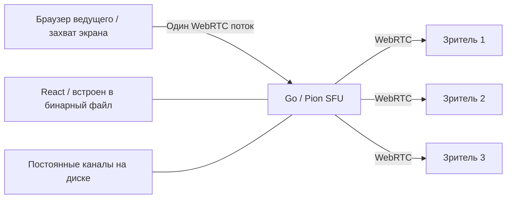

# Sidecast v2

Sidecast — новое название LANPlay. Папка `data/`, форматы ключей и ссылки `/watch/<никнейм>` сохранены. Студия распознаёт ключ владельца, ранее сохранённый LANPlay в том же браузере и по тому же адресу.

Самостоятельный сервер трансляций экрана: **React + TypeScript** для интерфейса, **Go + Pion WebRTC** для передачи видео и звука. Интерфейс встроен в один исполняемый файл; на устройстве сервера не нужны Node.js, браузер или отдельная папка со статикой.

## Режим захвата

Текущие сборки используют только браузерный захват видео и звука. Отдельная сборка Sidecast Studio с FFmpeg/WASAPI временно отключена. Её исходники сохранены в `cmd/sidecast-studio`, `internal/localstudio`, `internal/nativecapture` и `native/windows`; основной исполняемый файл их не включает.

## Постоянная ссылка

Ведущий выбирает никнейм, например `cyber`, и получает адрес:

```text
https://stream.example.com/watch/cyber
```

Канал сохраняется в `data/channels.json`. Остановка эфира, закрытие вкладки и перезапуск Go-сервера **не освобождают никнейм**. Между эфирами страница зрителя ждёт начала трансляции, во время эфира подключается автоматически. Уже открытая страница переподключается после следующего старта без обновления ссылки.

Право вести эфир подтверждает случайный 256-битный ключ владельца. Он сохраняется в браузере; скачайте резервную копию в блоке «Ключ владельца и восстановление». Для переноса в другой браузер введите никнейм и этот ключ в форме восстановления. Секрет не входит в ссылку зрителя; на сервере хранится только его хеш.

Постоянство ссылки требует постоянного **адреса сервера**: домена или закреплённого IP в локальной сети. Никнейм сохраняет путь, но не заменяет DNS и маршрутизацию.

## Быстрый запуск

Готовый файл запускается без установки зависимостей:

```powershell
# Windows
.\build\windows-amd64\sidecast-windows-amd64.exe --data .\data
```

```sh
# Linux
chmod +x ./sidecast-linux-amd64
./sidecast-linux-amd64 --data ./data
```

Откройте **http://localhost:8080** в Chrome или Edge. Создайте канал, сохраните ключ, нажмите «Начать трансляцию» и выберите источник в диалоге браузера. Для аудио включите передачу звука в этом диалоге. Зрителю отправьте ссылку из блока канала; при запуске студии через localhost там предлагается сетевой IP сервера. Если интерфейсов несколько, выберите подходящий.

На Windows EXE запускается без консольного окна, сразу открывает **http://localhost:8080/studio** в браузере по умолчанию и остаётся в системном трее. При другом порте или HTTPS адрес студии меняется автоматически. Правый клик по значку: «Открыть Sidecast» и «Выход». Двойной клик снова открывает студию. Кнопка **«Выключить приложение»** в студии и «Выход» в трее полностью завершают процесс, останавливая HTTP-сервер и все WebRTC-соединения. Кнопка доступна только при открытии студии через `localhost`, `127.0.0.1` или `[::1]` на компьютере приложения; зрители и посетители по сетевому адресу выключить сервер не могут. После выключения вкладка показывает сообщение о завершении; её можно закрыть. Простое закрытие вкладки оставляет сервер работающим. `start.cmd` запускает приложение с существующей папкой `data/` проекта. `stop.cmd` завершает его через ту же обработку выхода. Для служб и автоматизации используйте `--no-tray`: трей и автоматическое открытие браузера отключаются. Ошибки запуска, например занятый порт, показываются отдельным окном.

У Windows EXE встроена та же иконка, что у трея и сайта. Она отображается в Проводнике и ярлыках без отдельного файла рядом с приложением.

## Сборка из исходников

Нужны Node.js **20.11+** и Go **1.25+** (точный минимум — в `go.mod`).

```sh
npm ci
npm run build:app
```

Результат находится в `build/<ОС>-amd64/`, например `build/windows-amd64/sidecast-windows-amd64.exe`. Доступны только **Windows x64** и **Linux x64**. `npm run build:app` оставляет сборку текущей платформы (Windows или Linux на x64); `npm run build:all` создаёт обе. Все сборки используют `CGO_ENABLED=0`. ARM и варианты для роутеров не создаются; старые артефакты этих платформ удаляются при следующей сборке.

Каждая сборка сначала очищает известные старые артефакты, включая `native`, `optimized`, `studio` и прежние бинарные файлы в корне `build/`. Для отдельной очистки есть `npm run build:clean`. В корне `build/` остаются только каталоги платформ и общие `LICENSE`, `THIRD_PARTY_NOTICES.txt`, `SHA256SUMS` (пути в контрольных суммах указаны относительно `build/`). Перед пересборкой завершите запущенный EXE.

Данные каналов не входят в сборку и не удаляются при очистке. Windows EXE внутри `build/<платформа>/` по умолчанию использует `data/` в корне проекта; после переноса EXE в другое место — папку `data` рядом с ним. Явный `--data` задаёт другой путь. Linux по умолчанию использует `data/` относительно рабочей папки. Непустой старый `build/data/` сохраняется; если данные обнаружены внутри очищаемых каталогов, очистка прерывается с ошибкой до удаления файлов.

Для ручной сборки после `npm run build`:

```sh
CGO_ENABLED=0 GOOS=linux GOARCH=amd64 go build -trimpath -ldflags="-s -w" -o sidecast ./cmd/sidecast
```

Список команд разработки и проверки — в [CONTRIBUTING.md](CONTRIBUTING.md).

## Как устроен стриминг



Go принимает и пересылает RTP без декодирования и перекодирования. Ведущий отправляет один поток независимо от числа зрителей; исходящий трафик сервера растёт с каждым зрителем. По умолчанию в канале до 8 зрителей.

Есть видео и звук, предпросмотр, запрос 30/60/120 FPS, ограничение битрейта, фактические показатели WebRTC, полноэкранный режим, Picture-in-Picture и автоматическое переподключение зрителя. Звук зрителя включается кнопкой в плеере. Захват системного/оконного звука и 120 FPS зависят от браузера, ОС, источника и ресурсов компьютера.

SFU пока передаёт одно качество всем зрителям: симулкаст, индивидуальный выбор слоя, транскодирование и запись не реализованы. Браузер управляет перегрузкой исходящего потока, но отдельного адаптивного контроллера качества для медленных зрителей пока нет. Go сам по себе не гарантирует низкую задержку: её нужно измерять на целевом устройстве и сети. Сетевой пинг в UI не равен полной задержке картинки.

## Сервер на другом устройстве

Захват экрана разрешён браузером через **HTTPS** или через исключение для `localhost`. Если Go работает на отдельном сервере, ведущий открывает студию по HTTPS. Можно передать сертификат и ключ непосредственно Go:

```sh
./sidecast --listen :8443 --data ./data --tls-cert cert.pem --tls-key key.pem --public-url https://stream.example.com:8443
```

Сертификат должен быть принят/доверен браузером. Автоматической установки сертификатов и выдачи ACME в приложении нет. Альтернатива — HTTPS reverse proxy перед Go.

## Доступ через интернет

Нужны постоянный домен, HTTPS для интерфейса и достижимый медиамаршрут между браузерами и Go. HTTP-прокси сам по себе не переносит WebRTC UDP. Для NAT настройте STUN/TURN, например:

```sh
./sidecast --public-url https://stream.example.com --udp-ports 50000-50100 --ice-servers '[{"urls":["stun:stun.example.com:3478"]},{"urls":["turn:turn.example.com:3478"],"username":"temporary-user","credential":"temporary-password"}]'
```

Адреса выше — примеры, нужен ваш работающий STUN/TURN. ICE-серверы используются и Go, и браузерами; учётные данные из конфигурации доступны клиентам. Для публичного сервиса используйте временные TURN-учётные данные. Входящий TCP нужен для сайта, выбранные UDP-порты — для прямого медиамаршрута. При сложном NAT может потребоваться TURN. Подробности ограничений безопасности — в [SECURITY.md](SECURITY.md).

## Поддерживаемые платформы

| Платформа | Сборка | Статус |
| --- | --- | --- |
| Windows x64 | `windows-amd64` | Проверена локально |
| Linux x64 | `linux-amd64` | Кросс-сборка; запуск на устройстве требует проверки |

Пример systemd-службы для обычного Linux — [`deploy/systemd/sidecast.service`](deploy/systemd/sidecast.service); заранее создайте пользователя `sidecast` и установите бинарный файл в `/usr/local/bin/sidecast`.

## Управление отправкой зрителям

У каждого зрителя собственная оценка доступной скорости (GCC по обратной связи TWCC) и очередь равномерной отправки RTP. Медленная или заблокированная отправка одному зрителю не задерживает ведущего и других зрителей. Для каждого соединения заново формируются транспортные RTP-заголовки; повторная передача потерянных пакетов (NACK/RTX) сохраняется.

Для редких обновлений экрана низкая оценка скорости сама по себе не означает перегрузку сети. Пока потери или рост задержки не сохраняются хотя бы секунду, темп отправки учитывает фактический входящий поток и всплески ключевых кадров. При подтверждённой перегрузке используется оценка GCC; запас на заголовки и повторные передачи составляет 50%.

Очередь ограничена 8 МиБ, 8192 пакетами и возрастом ожидающего пакета 500 мс. При переполнении, устаревании очереди или ошибке отправки закрывается только соединение перегруженного зрителя; страница использует существующее автоматическое переподключение. Пакеты до установления соединения не накапливаются. Это защита задержки и памяти, а не индивидуальное снижение качества: ведущий по-прежнему кодирует один общий поток. Если пропускная способность зрителя постоянно ниже скорости этого потока, нужно снизить настройки ведущего; для автоматического выбора разрешения каждому зрителю потребуется simulcast/SVC или перекодирование.

Ключевой кадр запрашивается при установлении соединения зрителя и по запросу восстановления PLI/FIR. Запросы всех зрителей объединяются: не чаще одного в секунду на канал, с отложенным запросом для подключившихся внутри этого интервала. Периодические запросы каждые две секунды удалены; при отсутствии зрителей запросы не отправляются. Сам кодировщик браузера также может создавать ключевые кадры самостоятельно.

## Параметры

| Флаг | По умолчанию | Назначение |
| --- | --- | --- |
| `--listen` | `:8080` | Адрес HTTP/HTTPS |
| `--data` | `data` | Постоянная папка каналов; один процесс на папку |
| `--public-url` | пусто | Общий origin для постоянных ссылок |
| `--tls-cert`, `--tls-key` | пусто | Пара PEM-файлов для HTTPS |
| `--ice-servers` | `[]` | JSON-конфигурация STUN/TURN |
| `--udp-ports` | динамические | Диапазон UDP `min-max` для WebRTC |
| `--max-viewers` | `8` | Зрителей в канале, 1–64 |

Делайте резервную копию `data/` и ключа владельца. При утрате базы никнеймы и права не сохранятся. Не запускайте два процесса с одной папкой данных. Записи трансляций не создаются. Просмотр по ссылке публичный, без пароля.

## Docker

```sh
docker build -t sidecast .
mkdir -p data
sudo chown 65532:65532 data
docker run --rm --network host -v "$PWD/data:/data" sidecast
```

Пример для Linux: host networking упрощает адреса ICE. Контейнер запускается от непривилегированного пользователя; каталог `/data` должен быть доступен UID 65532. Настройте HTTPS перед использованием студии на другом устройстве. Docker Desktop и bridge networking требуют отдельной настройки сетевого маршрута WebRTC. Образ локально не проверялся, если Docker отсутствует.

## Структура

```text
cmd/sidecast/        точка входа Go, параметры, запуск и завершение
internal/channels/ постоянные никнеймы и хеши ключей
internal/media/    WebRTC SFU, сессии, RTP и RTCP
internal/httpapi/  HTTP API, права доступа и раздача интерфейса
web/src/
  components/      визуальные компоненты
  pages/           студия и страница зрителя
  hooks/           жизненный цикл эфира, просмотра и статистики
  lib/             HTTP, WebRTC и хранение ключа в браузере
  styles/          стили макета, студии и плеера
scripts/           сборка, кросс-компиляция и браузерная проверка
deploy/            примеры автозапуска
stable/            сохранённые исходники первой версии
```

## GitHub

В репозитории есть MIT-лицензия, инструкции для участников, политика безопасности и GitHub Actions для тестов и кросс-сборок. Тег `v*` запускает создание **предварительного** GitHub Release с бинарными файлами. До публикации задайте владельца/название репозитория и включите private vulnerability reporting. Папки данных, ключи, сертификаты, зависимости и готовые сборки исключены из Git. Из этой рабочей папки ничего автоматически не публикуется.

Основные зависимости: [Pion WebRTC](https://github.com/pion/webrtc), [React](https://react.dev/), [Vite](https://vite.dev/) и [Lucide](https://lucide.dev/). При распространении учитывайте их лицензии и лицензии транзитивных зависимостей.
