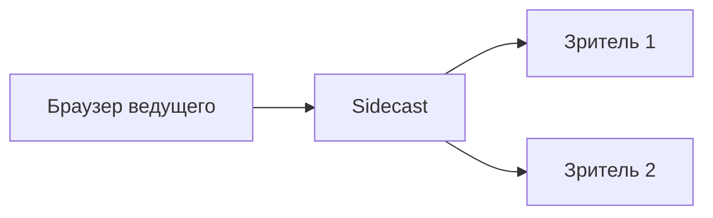

# Sidecast

Трансляции экрана и звука на своём сервере с постоянной ссылкой на канал.

## Как запустить

Доступны сборки для **Windows x64** и **Linux x64**. Скачайте готовую сборку во вкладке [GitHub Releases](https://github.com/Cybervaldemar/sidecast/releases): в разделе **Assets** нужного релиза выберите `sidecast-windows-amd64.exe` или `sidecast-linux-amd64`. Для запуска готового файла не нужны Node.js и Go. Если подходящей сборки ещё нет, создайте её по инструкции ниже.

По умолчанию используется HTTP. HTTPS можно настроить отдельно — приложение не требует сертификат для запуска или просмотра.

### Windows

Запустите `sidecast-windows-amd64.exe` двойным щелчком. Студия автоматически откроется в браузере по адресу **http://localhost:8080/studio**, а значок приложения появится в трее.

### Linux

```sh
chmod +x ./sidecast-linux-amd64
./sidecast-linux-amd64 --data ./data
```

Откройте **http://localhost:8080/studio** в браузере на компьютере приложения.

### Первый эфир

Для захвата экрана используйте Chrome или Edge. Ведущий открывает студию через `localhost`, а зрители — ссылку с локальным IP компьютера. IP определяется автоматически; указывать его в файлах не нужно.

1. Создайте канал: выберите никнейм и сохраните ключ владельца.
2. Выберите в студии предпочтительный источник звука и нажмите **«Начать трансляцию»**. В диалоге браузера выберите окно, вкладку или экран и решите, передавать ли звук. Переключатель звука в браузере определяет, получит ли Sidecast аудиодорожку; выбор источника в студии влияет только на варианты, которые предлагает браузер.
3. Нажмите **«Ссылка на стрим»** в блоке канала и отправьте скопированную ссылку зрителям. Устройства в той же локальной сети смогут открыть её по сетевому IP сервера. Если сетей несколько, адрес для зрителей можно выбрать в этом же блоке.

Для полного завершения нажмите **«Выключить приложение»** в локальной студии или **«Выход»** в трее Windows. В Linux также можно нажать `Ctrl+C` в терминале. Закрытие вкладки браузера оставляет приложение работающим.

Когда на GitHub появляется новая версия, локальная студия сообщает об этом. В Windows подтвердите обновление: Sidecast скачает новую сборку и перезапустится. Для замены файла нужна возможность записи в папку приложения; иначе скачайте его из релиза и замените вручную. В Linux студия покажет ссылку на релиз для ручной замены исполняемого файла. На время перезапуска текущий эфир прервётся.

## Запуск и разработка

Нужны **Node.js 20.11+** и **Go 1.25+**.

### Собрать приложение

В корне репозитория выполните:

```sh
npm ci
npm run build:app
```

Готовый файл появится в `build/windows-amd64/` или `build/linux-amd64/` — в зависимости от вашей системы. Команда `npm run build:all` собирает обе версии. Перед пересборкой завершите запущенное приложение.

### Работать с исходниками

Запустите сервер:

```sh
npm run dev:server
```

В другом терминале запустите интерфейс:

```sh
npm run dev
```

Студия разработки доступна по адресу **http://localhost:5173**. Сервер работает на порту **8080**.

Для проверки изменений используйте `npm run check` и `npm test`. Остальные команды и инструкции по тестированию — в [CONTRIBUTING.md](CONTRIBUTING.md).

## Как устроен стриминг

Браузер ведущего захватывает экран и звук и отправляет их в Sidecast. Сервер пересылает поток зрителям без перекодирования и записи.



Ведущий отправляет один поток независимо от количества зрителей. С каждым зрителем растёт исходящий трафик сервера.

Зрители открывают постоянную ссылку на канал. До начала эфира страница показывает ожидание, во время трансляции подключается автоматически. По той же ссылке можно смотреть следующие эфиры.

Интерфейс написан на React и TypeScript, сервер — на Go с Pion WebRTC. Интерфейс встроен в исполняемый файл.

## Что ещё важно

- **Канал и ключ.** Никнейм сохраняется после перезапуска. Ключ владельца хранится в браузере; скачайте резервную копию для восстановления или переноса в другой браузер. Ключи прежней версии LANPlay поддерживаются.
- **Данные.** Сохраняйте резервную копию папки данных и храните её вне `build/`. Путь можно задать параметром `--data`.
- **Доступ.** Если сетевой IP компьютера изменится, изменится и ссылка для зрителей. Для постоянной ссылки используйте неизменный адрес сервера.
- **Интернет.** Нужны доступный адрес сервера и возможность установить WebRTC-соединение. Для публичного размещения рекомендуется HTTPS. В некоторых сетях потребуется STUN/TURN.
- **Звук и качество.** Захват системного звука и доступная частота кадров зависят от браузера, ОС и выбранного источника. По умолчанию в канале до 8 зрителей; лимит меняется через `--max-viewers`.
- **Динамичные игры.** По умолчанию выбран приоритет плавности, 60 FPS и лимит 20 Мбит/с. В студии доступны лимиты 6, 12, 20 и 40 Мбит/с. Это верхняя граница: фактический битрейт зависит от сцены, кодировщика и сети. Браузер ведущего может уменьшить размер кадра по состоянию соединения с сервером. Режим «Сохранять разрешение» удерживает размер кадра, но может заметно снижать FPS. Сервер пересылает один закодированный поток всем зрителям: медленное соединение отдельного зрителя не снижает его качество автоматически. При перегрузке изображение может останавливаться и соединение переподключится. Исходящий трафик сервера растёт с каждым зрителем.
- **Игровой звук.** Приложение запрашивает у источника стерео и частоту 48 кГц, если браузер может их предоставить; речевое шумоподавление, подавление эха и автоматическое изменение громкости отключаются, если браузер это позволяет. Для передачи запрашивается стерео Opus до 256 кбит/с; сервер пересылает закодированный звук без обработки. Opus сжимает звук с потерями, поэтому побитовая точность невозможна.
- **Звуки контроллера.** При выборе окна игры браузер может захватить звук всего игрового процесса, включая сигналы, которые игра отправляет на динамик DualSense. В студии выберите **«Звук ПК»** и убедитесь, что основным устройством вывода Windows назначены ваши наушники или колонки, а DualSense использует отдельное устройство. Этот режим захватывает также другие звуки основного выхода. Если сигналы остаются, отключите динамик контроллера в настройках игры или Windows: из уже смешанной аудиодорожки Sidecast не может удалить только их. Параметры захвата зависят от браузера и ОС.
- **Приватность.** Трансляцию может смотреть каждый, у кого есть ссылка. Запись эфиров не ведётся.

## Документация

- [Разработка и тестирование](CONTRIBUTING.md)
- [Безопасность и ограничения](SECURITY.md)
- [Лицензия MIT](LICENSE)
