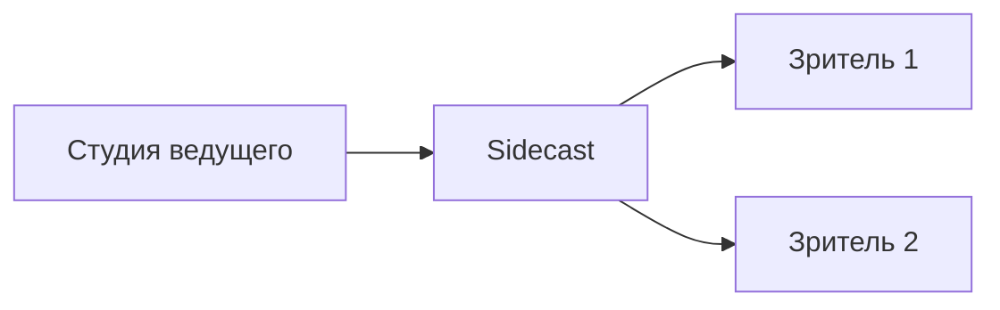

# Sidecast

Трансляции экрана и звука на своём сервере с постоянной ссылкой на канал.

## Как запустить

Доступны сборки для **Windows x64** и **Linux x64**. Скачайте готовую сборку во вкладке [GitHub Releases](https://github.com/Cybervaldemar/sidecast/releases): в разделе **Assets** нужного релиза выберите `sidecast-windows-amd64.exe` или `sidecast-linux-amd64`. Для запуска готового файла не нужны Node.js и Go. Если подходящей сборки ещё нет, создайте её по инструкции ниже.

По умолчанию используется HTTP. HTTPS можно настроить отдельно — приложение не требует сертификат для запуска или просмотра.

### Windows

Запустите `sidecast-windows-amd64.exe` двойным щелчком. Студия автоматически откроется в браузере по адресу **http://localhost:8080/studio**, а значок приложения появится в трее.

Экспериментальная сборка `sidecast-wails-windows-amd64.exe` открывает студию в собственном окне Wails. Захват монитора или окна и системного звука выполняется в Go; видео кодируется аппаратным H.264 через Windows Media Foundation, а при недоступном кодировщике используется VP8. Сервер и страница зрителя остаются внутри одного exe. На компьютере должен быть установлен Microsoft WebView2 Runtime. Ключ владельца в окне Wails хранится отдельно от браузера; для существующего канала импортируйте сохранённый ключ.

### Linux

```sh
chmod +x ./sidecast-linux-amd64
./sidecast-linux-amd64 --data ./data
```

Откройте **http://localhost:8080/studio** в браузере на компьютере приложения.

### Первый эфир

Ведущий открывает студию в окне Wails либо через `localhost` в Chrome или Edge. Зрители открывают ссылку с локальным IP компьютера. IP определяется автоматически; указывать его в файлах не нужно.

1. Создайте канал: выберите никнейм и сохраните ключ владельца.
2. В приложении Wails выберите монитор или окно и при необходимости включите системный звук, затем нажмите **«Начать трансляцию»**. В браузерной студии выберите источник звука, нажмите **«Начать трансляцию»** и выберите окно или экран в диалоге браузера; там же разрешите передачу звука.
3. Нажмите **«Ссылка на стрим»** в блоке канала и отправьте скопированную ссылку зрителям. Устройства в той же локальной сети смогут открыть её по сетевому IP сервера. Если сетей несколько, адрес для зрителей можно выбрать в этом же блоке.

Для полного завершения нажмите **«Выключить приложение»** в локальной студии, закройте окно Wails или выберите **«Выход»** в трее обычной Windows-сборки. В Linux также можно нажать `Ctrl+C` в терминале. Закрытие вкладки браузерной студии оставляет приложение работающим.

Когда на GitHub появляется новая версия, локальная студия сообщает об этом. В Windows подтвердите обновление: Sidecast скачает новую сборку и перезапустится. Для замены файла нужна возможность записи в папку приложения; иначе скачайте его из релиза и замените вручную. В Linux студия покажет ссылку на релиз для ручной замены исполняемого файла. На время перезапуска текущий эфир прервётся.

## Запуск и разработка

Нужны **Node.js 20.11+** и **Go 1.27.1+**.

### Собрать приложение

В корне репозитория выполните:

```sh
npm ci
npm run build:app
```

Готовый файл появится в `build/windows-amd64/` или `build/linux-amd64/` — в зависимости от вашей системы. Команда `npm run build:all` собирает обе версии. Перед пересборкой завершите запущенное приложение.

Для экспериментальной настольной версии на Windows x64 выполните `npm run build:wails`. Она создаст `build/windows-amd64/sidecast-wails-windows-amd64.exe`.

### Работать с исходниками

Запустите сервер:

```sh
npm run dev:server
```

В другом терминале запустите интерфейс:

```sh
npm run dev
```

Студия разработки доступна по адресу **http://localhost:5173**. Сервер работает на порту **8080**.

Для проверки изменений используйте `npm run check` и `npm test`. Остальные команды и инструкции по тестированию — в [CONTRIBUTING.md](CONTRIBUTING.md).

## Как устроен стриминг

В сборке Wails Go захватывает монитор через DXGI Desktop Duplication или GDI, окно через GDI, системный звук через WASAPI, кодирует видео аппаратным H.264 через Media Foundation и отправляет его зрителям по WebRTC. Если аппаратный кодировщик недоступен, используется программный VP8. Браузерная студия использует захват и кодирование браузера. Сервер пересылает поток зрителям без повторного кодирования и записи.



Ведущий отправляет один поток независимо от количества зрителей. С каждым зрителем растёт исходящий трафик сервера.

Зрители открывают постоянную ссылку на канал. До начала эфира страница показывает ожидание, во время трансляции подключается автоматически. По той же ссылке можно смотреть следующие эфиры.

Интерфейс написан на React и TypeScript, сервер — на Go с Pion WebRTC. Интерфейс встроен в исполняемый файл.

## Что ещё важно

- **Канал и ключ.** Никнейм сохраняется после перезапуска. Ключ владельца хранится в браузере; скачайте резервную копию для восстановления или переноса в другой браузер. Ключи прежней версии LANPlay поддерживаются.
- **Данные.** Сохраняйте резервную копию папки данных и храните её вне `build/`. Путь можно задать параметром `--data`.
- **Доступ.** Если сетевой IP компьютера изменится, изменится и ссылка для зрителей. Для постоянной ссылки используйте неизменный адрес сервера.
- **Интернет.** Нужны доступный адрес сервера и возможность установить WebRTC-соединение. Для публичного размещения рекомендуется HTTPS. В некоторых сетях потребуется STUN/TURN.
- **Звук и качество.** В Wails звук основного устройства вывода захватывается через WASAPI и кодируется в Opus. Доступная частота кадров зависит от монитора, кодировщика и нагрузки. В браузерной студии доступность звука зависит также от браузера и источника. По умолчанию в канале до 8 зрителей; лимит меняется через `--max-viewers`.
- **Динамичные игры.** Студия запрашивает частоту кадров до доступной частоты источника без ограничения на 60 FPS. Фактические 60, 160 FPS и разрешение зависят от захвата, кодировщика и нагрузки. Ручной выбор битрейта убран: сервер использует оценки соединений зрителей, а WebRTC также учитывает соединение ведущего. Верхняя граница видео — 40 Мбит/с. При нескольких зрителях сервер выбирает скорость с учётом самого медленного соединения. Режим «Сохранять разрешение» может снижать FPS. Исходящий трафик сервера растёт с каждым зрителем.
- **Игровой звук.** Приложение запрашивает у источника стерео и частоту 48 кГц, если браузер может их предоставить; речевое шумоподавление, подавление эха и автоматическое изменение громкости отключаются, если браузер это позволяет. Для передачи запрашивается стерео Opus до 256 кбит/с; сервер пересылает закодированный звук без обработки. Opus сжимает звук с потерями, поэтому побитовая точность невозможна.
- **Звуки контроллера.** При выборе окна игры браузер может захватить звук всего игрового процесса, включая сигналы, которые игра отправляет на динамик DualSense. В студии выберите **«Звук ПК»** и убедитесь, что основным устройством вывода Windows назначены ваши наушники или колонки, а DualSense использует отдельное устройство. Этот режим захватывает также другие звуки основного выхода. Если сигналы остаются, отключите динамик контроллера в настройках игры или Windows: из уже смешанной аудиодорожки Sidecast не может удалить только их. Параметры захвата зависят от браузера и ОС.
- **Приватность.** Трансляцию может смотреть каждый, у кого есть ссылка. Запись эфиров не ведётся.

## Документация

- [Разработка и тестирование](CONTRIBUTING.md)
- [Безопасность и ограничения](SECURITY.md)
- [Лицензия MIT](LICENSE)
