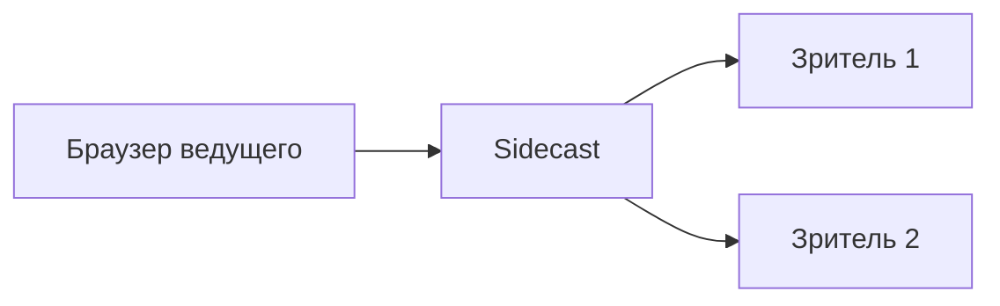

# Sidecast

Трансляции экрана и звука на своём сервере с постоянной ссылкой на канал.

## Как запустить

Доступны сборки для **Windows x64** и **Linux x64**. Для запуска готового файла не нужны Node.js и Go. Если сборки ещё нет, создайте её по инструкции ниже.

По умолчанию используется HTTP. HTTPS можно настроить отдельно — приложение не требует сертификат для запуска или просмотра.

### Windows

Запустите `sidecast-windows-amd64.exe` двойным щелчком. Студия автоматически откроется в браузере по адресу **http://localhost:8080/studio**, а значок приложения появится в трее.

### Linux

```sh
chmod +x ./sidecast-linux-amd64
./sidecast-linux-amd64 --data ./data
```

Откройте **http://localhost:8080/studio** в браузере на компьютере приложения.

### Первый эфир

Для захвата экрана используйте Chrome или Edge. Ведущий открывает студию через `localhost`, а зрители — ссылку с локальным IP компьютера. IP определяется автоматически; указывать его в файлах не нужно.

1. Создайте канал: выберите никнейм и сохраните ключ владельца.
2. Нажмите **«Начать трансляцию»**, выберите окно, вкладку или экран. Для передачи звука включите его в диалоге браузера.
3. Скопируйте ссылку из блока канала и отправьте зрителям. Устройства в той же локальной сети смогут открыть её по сетевому IP сервера. Если сетей несколько, адрес для зрителей можно выбрать в этом же блоке.

Для полного завершения нажмите **«Выключить приложение»** в локальной студии или **«Выход»** в трее Windows. В Linux также можно нажать `Ctrl+C` в терминале. Закрытие вкладки браузера оставляет приложение работающим.

## Запуск и разработка

Нужны **Node.js 20.11+** и **Go 1.25+**.

### Собрать приложение

В корне репозитория выполните:

```sh
npm ci
npm run build:app
```

Готовый файл появится в `build/windows-amd64/` или `build/linux-amd64/` — в зависимости от вашей системы. Команда `npm run build:all` собирает обе версии. Перед пересборкой завершите запущенное приложение.

### Работать с исходниками

Запустите сервер:

```sh
npm run dev:server
```

В другом терминале запустите интерфейс:

```sh
npm run dev
```

Студия разработки доступна по адресу **http://localhost:5173**. Сервер работает на порту **8080**.

Для проверки изменений используйте `npm run check` и `npm test`. Остальные команды и инструкции по тестированию — в [CONTRIBUTING.md](CONTRIBUTING.md).

## Как устроен стриминг

Браузер ведущего захватывает экран и звук и отправляет их в Sidecast. Сервер пересылает поток зрителям без перекодирования и записи.



Ведущий отправляет один поток независимо от количества зрителей. С каждым зрителем растёт исходящий трафик сервера.

Зрители открывают постоянную ссылку на канал. До начала эфира страница показывает ожидание, во время трансляции подключается автоматически. По той же ссылке можно смотреть следующие эфиры.

Интерфейс написан на React и TypeScript, сервер — на Go с Pion WebRTC. Интерфейс встроен в исполняемый файл.

## Что ещё важно

- **Канал и ключ.** Никнейм сохраняется после перезапуска. Ключ владельца хранится в браузере; скачайте резервную копию для восстановления или переноса в другой браузер. Ключи прежней версии LANPlay поддерживаются.
- **Данные.** Сохраняйте резервную копию папки данных и храните её вне `build/`. Путь можно задать параметром `--data`.
- **Доступ.** Если сетевой IP компьютера изменится, изменится и ссылка для зрителей. Для постоянной ссылки используйте неизменный адрес сервера.
- **Интернет.** Нужны доступный адрес сервера и возможность установить WebRTC-соединение. Для публичного размещения рекомендуется HTTPS. В некоторых сетях потребуется STUN/TURN.
- **Звук и качество.** Захват системного звука и доступная частота кадров зависят от браузера, ОС и выбранного источника. По умолчанию в канале до 8 зрителей; лимит меняется через `--max-viewers`.
- **Игровой звук.** Для Opus запрашиваются стерео, 48 кГц и до 256 кбит/с, без речевого шумоподавления и автоматического изменения громкости. Стерео сохраняется, если его предоставляет выбранный источник захвата.
- **Приватность.** Трансляцию может смотреть каждый, у кого есть ссылка. Запись эфиров не ведётся.

## Документация

- [Разработка и тестирование](CONTRIBUTING.md)
- [Безопасность и ограничения](SECURITY.md)
- [Лицензия MIT](LICENSE)
